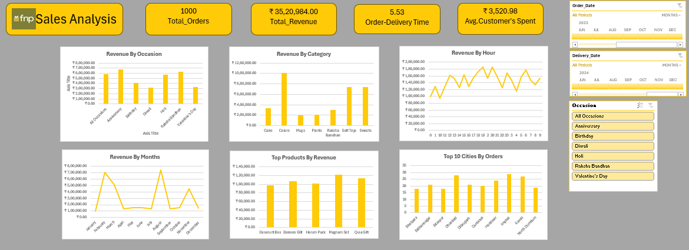

# FNP Sales Analysis Dashboard (Excel)

An interactive Excel dashboard analysing 1,000 gifting orders to understand what drives revenue, when customers buy, and where orders come from.

## Executive Summary

The business generated **₹35.21 lakh in revenue from 1,000 orders**, an average of **₹3,520.98 per customer**, with orders delivered in an average of **5.53 days**. Revenue is strongly **seasonal and festival-driven**: two months (February and August) account for roughly 40% of annual revenue, while most other months stay flat at around ₹1–1.5 lakh. Product revenue is led by **Colors, Soft Toys and Sweets**, and demand is spread across many smaller cities rather than concentrated in a few metros.

## Key Performance Indicators

| KPI | Value |
|---|---|
| Total Orders | 1,000 |
| Total Revenue | ₹35,20,984 |
| Avg. Customer Spend | ₹3,520.98 |
| Avg. Order-to-Delivery Time | 5.53 days |

## Key Insights

1. **Revenue is highly seasonal.** Revenue peaks in **August (~₹7.3L, Raksha Bandhan)** and **February (~₹7L, Valentine's Day)**, with secondary peaks in **March (Holi)** and **November (Diwali)**. Between these festivals, monthly revenue falls back to roughly ₹1–1.5L.
2. **Occasion revenue is fairly balanced across the major events.** Anniversary, Raksha Bandhan and Holi each bring in around ₹5.5–6.7L, ahead of Birthday, Diwali and Valentine's Day (~₹3–4L each).
3. **Colors is the top category** at roughly ₹10L, about 29% of total revenue. **Soft Toys and Sweets** follow at ~₹7.3L each. Cake, Raksha Bandhan items, Mugs and Plants contribute much less.
4. **Evening is the peak buying window.** Hourly revenue climbs through the day and peaks around 6–8 PM (~₹1.8L per hour), with a clear low in the early-morning hours.
5. **Top products perform in a tight range** (~₹1.0–1.2L each), led by Magnam Set and Quia Gift, so no single product dominates revenue.
6. **Demand is geographically spread.** The top 10 cities each place roughly 17–29 orders, with Imphal, Dhanbad and Karali leading. Smaller cities are a major source of volume.

## Recommendations

- **Plan inventory and marketing around the festival calendar**, building stock and campaigns ahead of February, March, August and November.
- **Run promotions in the off-peak months** (April–July, September–October, December) to smooth out the revenue dips.
- **Prioritise Colors, Soft Toys and Sweets** in the product mix and in featured placements, and review the low-contributing categories.
- **Schedule ads and offers for the evening peak** (around 6–8 PM) to capture the highest-intent traffic.
- **Look into the 5.53-day delivery time**, especially during festival peaks when speed matters most.

## Dashboard Features

- 4 KPI cards (orders, revenue, delivery time, average spend)
- 6 charts: Revenue by Occasion, Category, Hour and Month; Top Products by Revenue; Top 10 Cities by Orders
- Interactive slicers for **Order Date**, **Delivery Date** and **Occasion** to filter the whole dashboard

## Tools & Techniques

- Microsoft Excel: PivotTables, PivotCharts, Slicers, calculated fields
- Data cleaning and preparation
- Dashboard design and KPI reporting

## Author

**Rampur Mohammed Kaif**
[GitHub](https://github.com/kaifshaikh286)
